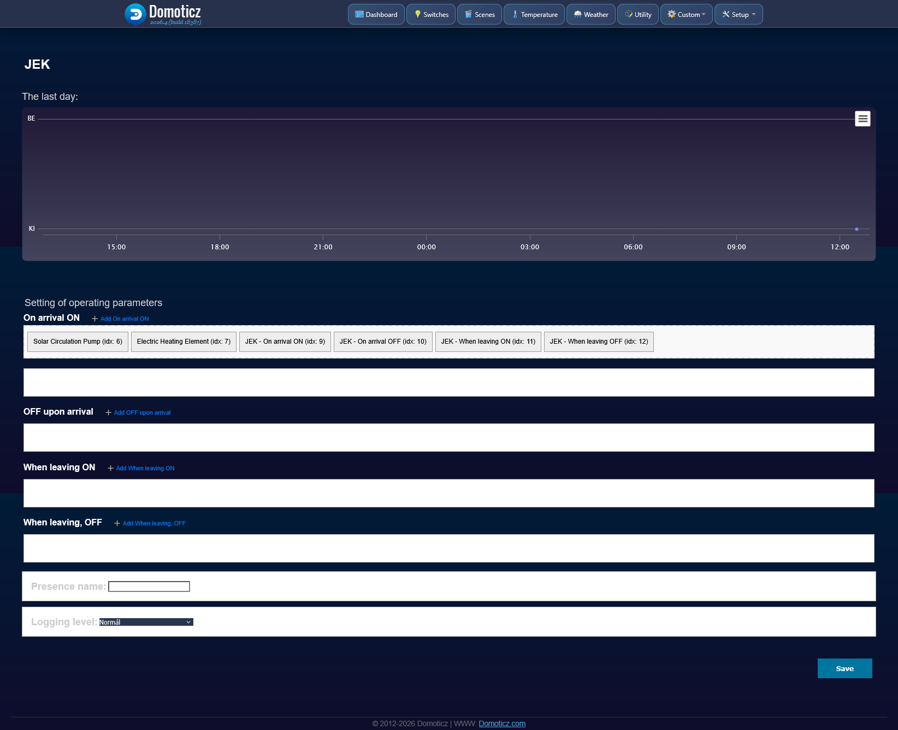
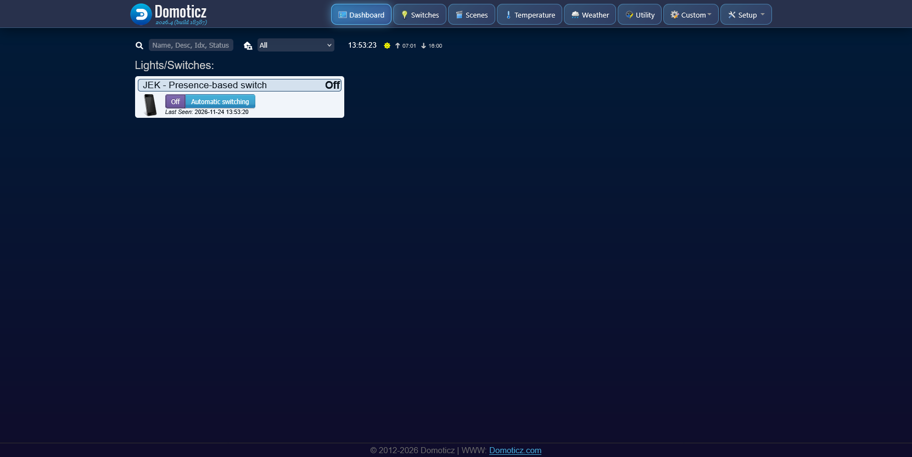
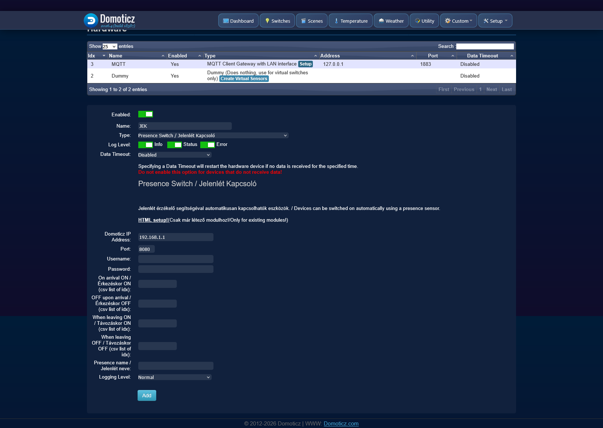

# Domoticz JEK Presence Switch

**Presence-based device control for Domoticz using OpenWrt**

A free and open-source Python plugin developed as part of the **Szélessáv Smart Home** project.

The plugin automatically switches Domoticz devices ON or OFF based on presence information provided by an OpenWrt router.

It allows you to configure different switching actions when someone is at home or when everyone is away.

The entire system operates locally, without external cloud services.

**Languages:** 16 translations

**Documentation:** [English](https://www.szelessavmuhely.hu/en/presence_switch) | [Magyar](https://www.szelessavmuhely.hu/hu/jelenlet_kapcsolo)

---

## Important – OpenWrt Presence Required

**This plugin works ONLY with the following presence monitoring solutions:**

1. **[OpenWrt Presence](https://github.com/szelessavalapitvany/openwrt-presence)** – our open-source presence monitoring service for OpenWrt routers.
2. **Szélessáv Smart Home firmware** – our custom OpenWrt firmware, which already includes the required presence monitoring service.

**The plugin does not perform presence detection itself.**

It retrieves presence information from the OpenWrt router and uses it to control Domoticz devices.

A standard OpenWrt installation without the required presence monitoring service is not sufficient.

## Main Features

- Automatic device switching based on presence or absence
- Four independent switching lists:
  - ON when presence is detected
  - OFF when presence is detected
  - ON when presence is no longer detected
  - OFF when presence is no longer detected
- Support for multiple devices in each list
- Selection of an OpenWrt presence group
- Automatic checking of device states
- Switching commands are sent only when necessary
- Manual Off / Automatic operating modes
- Dedicated HTML user interface
- Domoticz event logging and debugging options
- 16 language translations
- Local operation without cloud services

## How It Works

Presence monitoring is performed by the OpenWrt router.

The plugin periodically requests the status of the configured presence group and controls Domoticz devices accordingly.

| Presence status | Action |
|---|---|
| Present | Switch ON devices in the arrival ON list |
| Present | Switch OFF devices in the arrival OFF list |
| Absent | Switch ON devices in the departure ON list |
| Absent | Switch OFF devices in the departure OFF list |

The plugin checks the current state of each device before sending a switching command.

In automatic mode, the configured device states are checked periodically and restored if necessary.

## Screenshots

### HTML User Interface



### Domoticz Dashboard



### Plugin Configuration



## Installation

### Requirements

- Domoticz with Python plugin support
- OpenWrt router with [OpenWrt Presence](https://github.com/szelessavalapitvany/openwrt-presence), or Szélessáv Smart Home firmware
- At least one configured presence group
- Network connectivity between Domoticz and the OpenWrt router
- Git for downloading the plugin

### Download

Navigate to the Domoticz plugins directory and clone the repository:

```bash
git clone https://github.com/szelessavalapitvany/Domoticz-JEK-Presence-Switch.git JEK
```

The plugin should be located at:

```text
domoticz/plugins/JEK/plugin.py
```

If necessary, set the file permissions:

```bash
cd JEK
chmod +x plugin.py
```

Restart Domoticz after installation.

### Domoticz Configuration

1. Open **Setup → Hardware** in Domoticz.
2. Select **Jelenlét Kapcsoló** from the hardware type list.
3. Enter the Domoticz IP address and port.
4. Enter the presence group name configured on the OpenWrt router.
5. Configure the devices to switch ON or OFF.
6. Add the hardware.

The plugin automatically creates the required Domoticz devices, including the **Presence-based switch** selector.

### Device Lists

The four switching lists accept comma-separated Domoticz device IDs (IDX).

Example:

```text
1051,617,1054
```

Lists can be left empty if no action is required.

Avoid assigning the same device to conflicting ON and OFF lists for the same presence state.

## Operating Modes

The plugin creates a selector switch with two operating modes:

**Off**

Automatic switching is disabled. Existing device states remain unchanged.

**Automatic switching**

Devices are automatically controlled according to the presence status reported by the OpenWrt router.

## HTML Interface

The plugin includes a dedicated HTML user interface accessible from the Domoticz custom interface menu.

The plugin hardware must already exist before opening the HTML interface.

## Example Applications

- Turn on selected lights when someone arrives home.
- Switch off unnecessary electrical appliances when everyone leaves.
- Activate specific devices only when someone is present.
- Set different device states for home and away operation.

## Updates

To update a Git-cloned installation, navigate to the plugin directory and execute:

```bash
git pull
```

Restart Domoticz if required.

## Documentation

Complete technical documentation, installation instructions and configuration details:

- **English:** https://www.szelessavmuhely.hu/en/presence_switch
- **Magyar:** https://www.szelessavmuhely.hu/hu/jelenlet_kapcsolo

## Related Projects

- [OpenWrt Presence](https://github.com/szelessavalapitvany/openwrt-presence)
- [Domoticz JEK Presence Switch](https://github.com/szelessavalapitvany/Domoticz-JEK-Presence-Switch)

Developed by **Szélessáv Közhasznú Alapítvány** as part of the Szélessáv Smart Home project.

---

# Magyar – Jelenlét Kapcsoló

**Jelenlét alapú automatikus eszközvezérlés Domoticz rendszerhez, OpenWrt router használatával**

A **Jelenlét Kapcsoló (JEK)** a Szélessáv Okos Otthon projekt részeként fejlesztett, ingyenes, nyílt forráskódú Python plugin.

Feladata, hogy az OpenWrt router által szolgáltatott jelenlétinformációk alapján automatikusan be- vagy kikapcsolja a kiválasztott Domoticz eszközöket.

Külön kapcsolási műveletek állíthatók be arra az esetre, ha valaki otthon tartózkodik, illetve ha mindenki távol van.

A rendszer teljes egészében helyi hálózaton működik, külső felhőszolgáltatás nélkül.

**Nyelvek:** 16 nyelvi fordítás

**Dokumentáció:** [Magyar](https://www.szelessavmuhely.hu/hu/jelenlet_kapcsolo) | [English](https://www.szelessavmuhely.hu/en/presence_switch)

---

## Fontos – OpenWrt Presence szükséges

**A plugin KIZÁRÓLAG az alábbi jelenlétfigyelő megoldásokkal működik:**

1. **[OpenWrt Presence](https://github.com/szelessavalapitvany/openwrt-presence)** – az általunk fejlesztett, nyílt forráskódú OpenWrt jelenlétfigyelő szolgáltatás.
2. **Szélessáv Okos Otthon firmware** – saját OpenWrt firmware-változatunk, amely már tartalmazza a szükséges jelenlétfigyelő szolgáltatást.

**A plugin önállóan nem végez jelenlétérzékelést.**

A jelenlét állapotát az OpenWrt routertől kérdezi le, és az eredmény alapján vezérli a Domoticz eszközeit.

A szükséges jelenlétfigyelő szolgáltatás nélküli, hagyományos OpenWrt telepítés önmagában nem elegendő.

## Főbb funkciók

- Automatikus eszközkapcsolás jelenlét vagy távollét alapján
- Négy egymástól független kapcsolási lista:
  - Bekapcsolás jelenlét esetén
  - Kikapcsolás jelenlét esetén
  - Bekapcsolás távollét esetén
  - Kikapcsolás távollét esetén
- Több Domoticz eszköz kezelése listánként
- OpenWrt jelenléti csoport kiválasztása
- Az eszközök aktuális állapotának ellenőrzése
- Kapcsolási parancs csak szükség esetén
- Kézi Ki / Automatikus üzemmód
- Egyedi HTML kezelőfelület
- Domoticz naplózás és hibakeresési lehetőségek
- 16 nyelvi fordítás
- Helyi, felhőfüggetlen működés

## Működési elv

A jelenlétfigyelést az OpenWrt router végzi.

A plugin rendszeresen lekérdezi a beállított jelenléti csoport állapotát, majd ennek megfelelően vezérli a Domoticz eszközöket.

| Jelenléti állapot | Művelet |
|---|---|
| Jelenlét | Az érkezéskor ON listában szereplő eszközök bekapcsolása |
| Jelenlét | Az érkezéskor OFF listában szereplő eszközök kikapcsolása |
| Távollét | A távozáskor ON listában szereplő eszközök bekapcsolása |
| Távollét | A távozáskor OFF listában szereplő eszközök kikapcsolása |

A plugin kapcsolási parancs küldése előtt ellenőrzi az eszköz aktuális állapotát.

Automatikus üzemmódban rendszeresen ellenőrzi, és szükség esetén visszaállítja az előírt eszközállapotokat.

## Képernyőképek

### HTML kezelőfelület


### Domoticz kezdőoldal


### Plugin konfiguráció


## Telepítés

### Rendszerkövetelmények

- Domoticz Python plugin támogatással
- OpenWrt router [OpenWrt Presence](https://github.com/szelessavalapitvany/openwrt-presence) szolgáltatással, vagy Szélessáv Okos Otthon firmware
- Legalább egy beállított jelenléti csoport
- Hálózati kapcsolat a Domoticz és az OpenWrt router között
- Git a plugin letöltéséhez

### Letöltés

Lépjünk be a Domoticz plugins könyvtárába, majd töltsük le a projektet:

```bash
git clone https://github.com/szelessavalapitvany/Domoticz-JEK-Presence-Switch.git JEK
```

A plugin helye:

```text
domoticz/plugins/JEK/plugin.py
```

Szükség esetén állítsuk be a futtatási jogosultságot:

```bash
cd JEK
chmod +x plugin.py
```

A telepítés után indítsuk újra a Domoticz szolgáltatást.

### Domoticz konfiguráció

1. Nyissuk meg a **Beállítások → Hardver** menüpontot.
2. Válasszuk ki a **Jelenlét Kapcsoló** plugint.
3. Adjuk meg a Domoticz IP-címét és portját.
4. Adjuk meg az OpenWrt routeren beállított jelenléti csoport nevét.
5. Állítsuk be a kapcsolni kívánt eszközöket.
6. Adjuk hozzá a hardvert.

A plugin automatikusan létrehozza a szükséges Domoticz eszközöket, köztük a **Jelenlét alapú kapcsoló** választókapcsolót.

### Eszközlisták

A négy kapcsolási listában a Domoticz eszközök IDX azonosítóit kell megadni, vesszővel elválasztva.

Példa:

```text
1051,617,1054
```

A listák üresen hagyhatók, ha az adott művelethez nem szeretnénk eszközt rendelni.

Kerüljük, hogy ugyanaz az eszköz azonos jelenléti állapothoz tartozó, egymásnak ellentmondó ON és OFF listákban is szerepeljen.

## Üzemmódok

A plugin kétállapotú választókapcsolót hoz létre:

**Ki (Off)**

Az automatikus kapcsolás nem működik. A vezérelt eszközök meglévő állapota változatlan marad.

**Automatikus kapcsolás (Automatic switching)**

A plugin az OpenWrt router által jelzett jelenléti állapot alapján automatikusan vezérli az eszközöket.

## HTML kezelőfelület

A pluginhoz egyedi HTML kezelőfelület tartozik, amely a Domoticz egyedi menüpontjából érhető el.

A HTML kezelőfelület használatához előbb létre kell hozni a plugin hardverét a Domoticz rendszerben.

## Felhasználási példák

- Világítás automatikus bekapcsolása hazaérkezéskor.
- Feleslegesen működő elektromos berendezések kikapcsolása távozáskor.
- Meghatározott eszközök aktiválása jelenlét esetén.
- Eltérő eszközállapotok beállítása otthoni és távolléti üzemhez.

## Frissítés

A GitHubról klónozott telepítés frissítéséhez lépjünk be a plugin könyvtárába, majd futtassuk:

```bash
git pull
```

Szükség esetén indítsuk újra a Domoticz szolgáltatást.

## Dokumentáció

Részletes műszaki leírás, telepítés és konfiguráció:

- **Magyar:** https://www.szelessavmuhely.hu/hu/jelenlet_kapcsolo
- **English:** https://www.szelessavmuhely.hu/en/presence_switch

## Kapcsolódó projektek

- [OpenWrt Presence](https://github.com/szelessavalapitvany/openwrt-presence)
- [Domoticz JEK Presence Switch](https://github.com/szelessavalapitvany/Domoticz-JEK-Presence-Switch)

Fejlesztő: **Szélessáv Közhasznú Alapítvány – Szélessáv Okos Otthon projekt**
